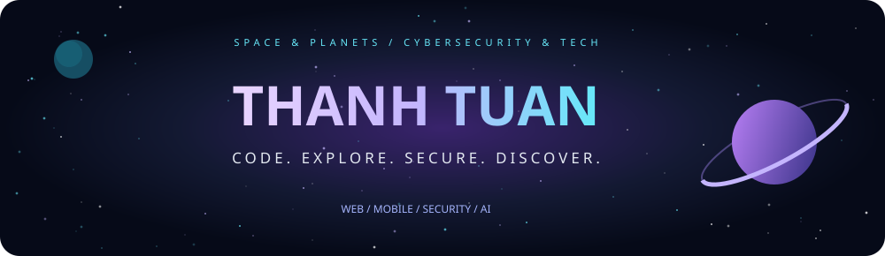
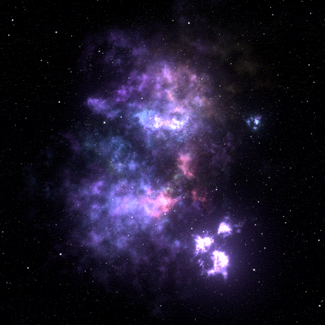
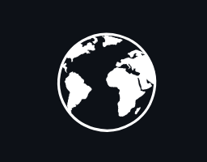
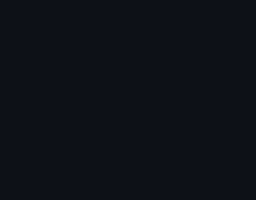
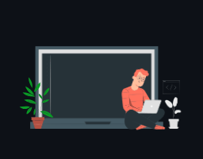
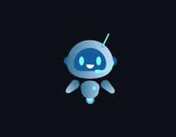
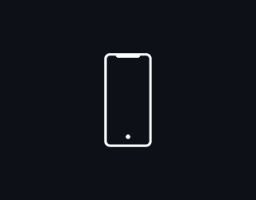

<div align="center">

<!-- ======================================================= -->
<!-- COSMIC HEADER SECTION                                  -->
<!-- ======================================================= -->



<p align="center">
  <a href="https://github.com/thanhtuanxzx">
    
  </a>
  
  
</p>

<!-- ======================================================= -->
<!-- INTERACTIVE NAVIGATION DECK                            -->
<!-- ======================================================= -->
<table>
  <tr>
    <td align="center" valign="middle" width="58%">
      <a href="https://giphy.com/gifs/MXQnyEQwBJ6eTj90L5">
        
      </a>
    </td>
    <td align="center" valign="middle" width="42%">
      <p><a href="#about"></a></p>
      <p><a href="#technology"></a></p>
      <p><a href="#ai"></a></p>
      <p><a href="#projects"></a></p>
      <p><a href="#telemetry"></a></p>
    </td>
  </tr>
</table>

<br />

<br />

<!-- ======================================================= -->
<!-- 01 / THE OBSERVATORY                                    -->
<!-- ======================================================= -->
<a id="about"></a>


### A curious mind, looking at the bigger picture.

<table>
  <tr>
    <td align="center" width="40%">
      <a href="https://giphy.com/gifs/sun-ctGFLebG1AqK4">
        
      </a>
    </td>
    <td align="left" width="60%">
      <h2>Hey, I'm Thanh Tuan (thanhtuanxzx) </h2>
      <p>I build robust applications, explore cyberspace vulnerabilities, and figure out how systems connect seamlessly.</p>
      <p>
         Space, planets &amp; the universe<br />
         Science, full-stack tech &amp; new possibilities<br />
         AI experiments &amp; LLM workflows<br />
         Web Penetration Testing, OWASP Top 10 &amp; Bug Bounty<br />
         Systems architecture &amp; the bigger picture
      </p>
      <p><em>Small experiments. Constant vigilance. Endless curiosity.</em></p>
    </td>
  </tr>
</table>

```bash
root@deep-space-node:~# neofetch --profile
---------------------------------------------------------------------------------
 OS        : Kali Linux / Linux 6.x-hardened x86_64
 Station   : Deep Space Observatory & Cybersecurity Lab
 Role      : Full-Stack Developer & Cybersecurity Enthusiast (Bug Bounty / Pentest)
 Focus     : Web & Mobile Apps | AI Integrations | Web App Penetration Testing
 Toolset   : Burp Suite Pro, Kali, Nmap, Docker, React, Node.js, Spring Boot
 Base      : Viet Nam 🇻🇳
 Status    : Building secure platforms & hunting vulnerabilities
 Portal    : https://element-trac.id.vn
---------------------------------------------------------------------------------
```

<p align="center">
  
  
  
  
  
</p>


<br />

<!-- ======================================================= -->
<!-- 02 / THE TECHNOLOGY DECK                                -->
<!-- ======================================================= -->
<a id="technology"></a>


### Different tools. Connected possibilities.

<table>
  <tr>
    <td align="center" width="33%">
      <h3> Languages</h3>
      <p></p>
    </td>
    <td align="center" width="33%">
      <h3> Interfaces &amp; Apps</h3>
      <p></p>
    </td>
    <td align="center" width="33%">
      <h3> Services &amp; Systems</h3>
      <p></p>
    </td>
  </tr>
  <tr>
    <td align="center" width="33%">
      <h3> Data &amp; Caching</h3>
      <p></p>
    </td>
    <td align="center" width="33%">
      <h3> Security &amp; Pentesting</h3>
      <p>
        <br />
        <br />
        
      </p>
    </td>
    <td align="center" width="33%">
      <h3> Tools &amp; Ops</h3>
      <p></p>
    </td>
  </tr>
</table>


<br />

<!-- ======================================================= -->
<!-- 03 / THE EXPERIMENT LAB                                 -->
<!-- ======================================================= -->
<a id="ai"></a>


### A little science. A little code. A lot to explore.

<table>
  <tr>
    <td align="center" width="35%">
      
    </td>
    <td align="center" width="65%">
      <h3> AI &amp; Security Research Playground</h3>
      <p>Notebooks · Models · Threat Intel · LLM APIs · CTF Writeups</p>
      <p>
        
        
        
      </p>
      <p>
        
        
        
      </p>
      <p><sub>Prompt experiments · Vulnerability scanners · Exploit proof-of-concepts · AI-assisted recon</sub></p>
    </td>
  </tr>
</table>


<br />

<!-- ======================================================= -->
<!-- 04 / THE PROJECT SYSTEM                                 -->
<!-- ======================================================= -->
<a id="projects"></a>


### Pick a destination. Explore something I have built.

<table>
  <tr>
    <td align="center" width="33%">
      <p></p>
      <h3>CEHub</h3>
      <p><sub>English learning platform</sub></p>
      <a href="https://cehub.element-trac-group.id.vn/" target="_blank">
        
      </a><br /><br />
    </td>
    <td align="center" width="33%">
      <p></p>
      <h3>Tourism AI</h3>
      <p><sub>Travel &amp; discovery assistant</sub></p>
      <a href="https://tourism.element-trac-group.id.vn/" target="_blank">
        
      </a><br /><br />
    </td>
    <td align="center" width="33%">
      <p></p>
      <h3>Science Journal</h3>
      <p><sub>Research &amp; publishing portal</sub></p>
      <a href="https://tapchikhoahoc.ctuet.edu.vn/" target="_blank">
        
      </a><br /><br />
    </td>
  </tr>
  <tr>
    <td align="center" width="33%">
      <p></p>
      <h3>Patient Portal</h3>
      <p><sub>Healthcare &amp; patient experience</sub></p>
      <a href="https://hospital.element-trac-group.id.vn/" target="_blank">
        
      </a><br /><br />
    </td>
    <td align="center" width="33%">
      <p></p>
      <h3>Staff Platform</h3>
      <p><sub>Internal hospital operations</sub></p>
      <a href="https://staff-hospital.element-trac-group.id.vn/" target="_blank">
        
      </a><br /><br />
    </td>
    <td align="center" width="33%">
      <p></p>
      <h3>Hospital API</h3>
      <p><sub>Backend services &amp; OpenAPI docs</sub></p>
      <a href="https://javabackend-s160.onrender.com/swagger-ui/index.html" target="_blank">
        
      </a><br /><br />
    </td>
  </tr>
  <tr>
    <td align="center" width="33%">
      <p></p>
      <h3>Charity Ledger</h3>
      <p><sub>Transparent donation tracking</sub></p>
      <a href="https://element-trac-charity-ledger.vercel.app/" target="_blank">
        
      </a><br /><br />
    </td>
    <td align="center" width="33%">
      <p></p>
      <h3>Thread Town</h3>
      <p><sub>Community conversations &amp; social</sub></p>
      <a href="https://thread-town.element-trac-group.id.vn/" target="_blank">
        
      </a><br /><br />
    </td>
    <td align="center" width="33%">
      <p></p>
      <h3>Attendance App</h3>
      <p><sub>Mobile attendance (React Native)</sub></p>
      <br /><br />
    </td>
  </tr>
</table>


<br />

<!-- ======================================================= -->
<!-- 05 / THE TELEMETRY DECK & AUDIO FREQUENCY               -->
<!-- ======================================================= -->
<a id="telemetry"></a>


### Flight Logs, Code Telemetry &amp; Frequencies

<p align="center">
  <a href="https://github.com/thanhtuanxzx">
    
  </a>
  <a href="https://github.com/thanhtuanxzx">
    
  </a>
</p>

<p align="center">
  <a href="https://github.com/thanhtuanxzx">
    
  </a>
</p>

<br />

<!-- Spotify Live Streaming -->
<h3> Tactical Audio Frequency / Spotify Stream</h3>

<p align="center">
  <a href="https://spotify-github-profile.kittinanx.com/api/view?uid=31hjtw36af72w65hrm7ttfmecvuu&redirect=true" target="_blank">
    
  </a>
</p>


<br />

<!-- ======================================================= -->
<!-- 06 / THE SIGNAL STATION                                 -->
<!-- ======================================================= -->
<a id="connect"></a>


###  Connect With Me

<table>
  <tr>
    <td align="center" width="38%">
      <a href="https://giphy.com/gifs/kippoapp-dating-astrology-kippo-m5t96aAfEAuObIMVoz">
        
      </a>
      <h3>LEO / THE LION</h3>
      <sub>My zodiac constellation.</sub>
    </td>
    <td align="center" width="62%">
      <h3> A signal from your side?</h3>
      <p>Say hello. Share an idea. Talk technology or security.</p>
      <p align="center">
        <a href="mailto:nguyenhoangthanh.dev@gmail.com" title="Gmail">
          
        </a>
        &nbsp;&nbsp;&nbsp;
        <a href="https://www.linkedin.com/in/thanh-nguy%E1%BB%85n-aaab0836a" target="_blank" title="LinkedIn">
          
        </a>
        &nbsp;&nbsp;&nbsp;
        <a href="https://www.facebook.com/nguyen.thanh.929165" target="_blank" title="Facebook">
          
        </a>
        &nbsp;&nbsp;&nbsp;
        <a href="https://element-trac.id.vn" target="_blank" title="Personal Website">
          
        </a>
      </p>
      <p><sub>Always curious about what comes next.</sub></p>
    </td>
  </tr>
</table>

<br />


<details>
  <summary>Animation sources &amp; icon license</summary>
  <br />
  <a href="https://giphy.com/gifs/MXQnyEQwBJ6eTj90L5">Violet nebula</a> · <a href="https://giphy.com/gifs/sun-ctGFLebG1AqK4">Sun</a> / GIPHY<br />
  <a href="https://giphy.com/gifs/kippoapp-dating-astrology-kippo-m5t96aAfEAuObIMVoz">Leo constellation</a> — Kippo / GIPHY<br />
  <a href="https://lottiefiles.com/free-animation/donaciones-xMlHVtkbGJ">Donation animation</a> / LottieFiles<br />
  <br />Project motion: <a href="https://lottiefiles.com/free-animation/hospital-H0XKUCP5gs">Patient</a> · <a href="https://lottiefiles.com/free-animation/globe-transparent-BgOdIoFKnp">Tourism</a> · <a href="https://lottiefiles.com/free-animation/live-chatbot-umPtBW5amb">Thread</a> · <a href="https://lottiefiles.com/free-animation/rotate-phone-kPnav83TO4">Attendance</a><br />
  <a href="https://lottiefiles.com/free-animation/document-ocr-scan-xjHvcgGQ7G">Science Journal document animation</a> / LottieFiles<br />
  Icons: Lucide · <a href="assets/icons/LICENSE">ISC license</a>
</details>

<br />


</div>
